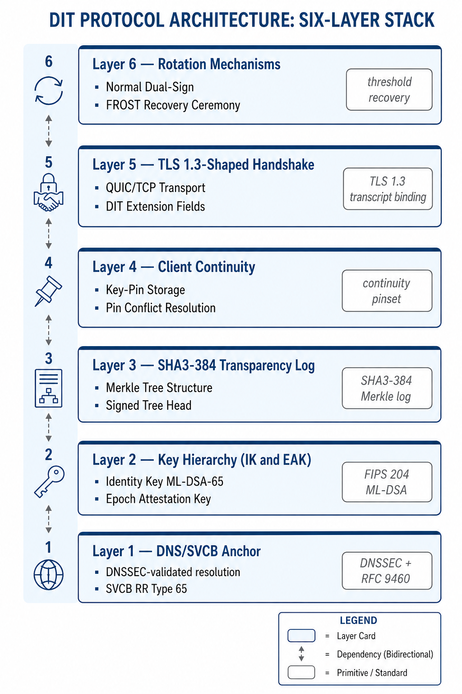
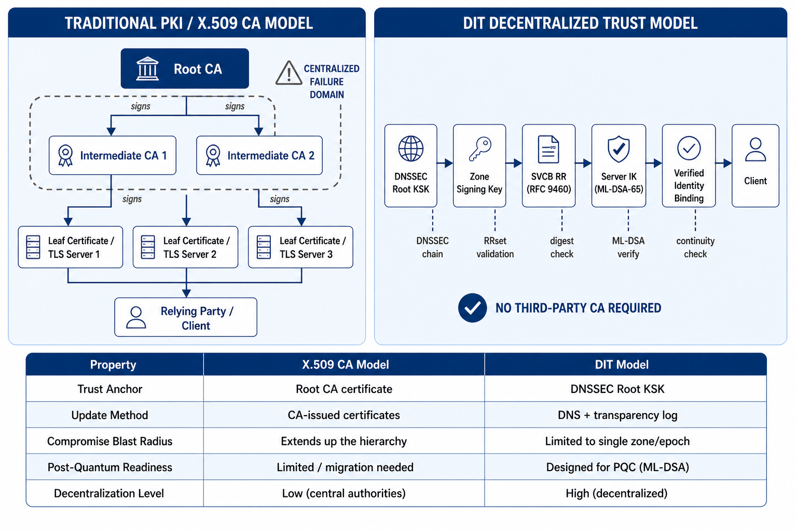
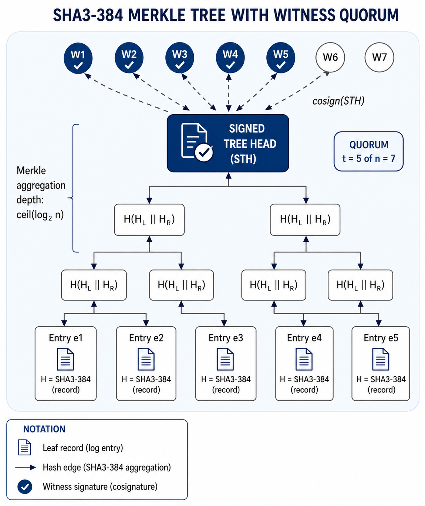
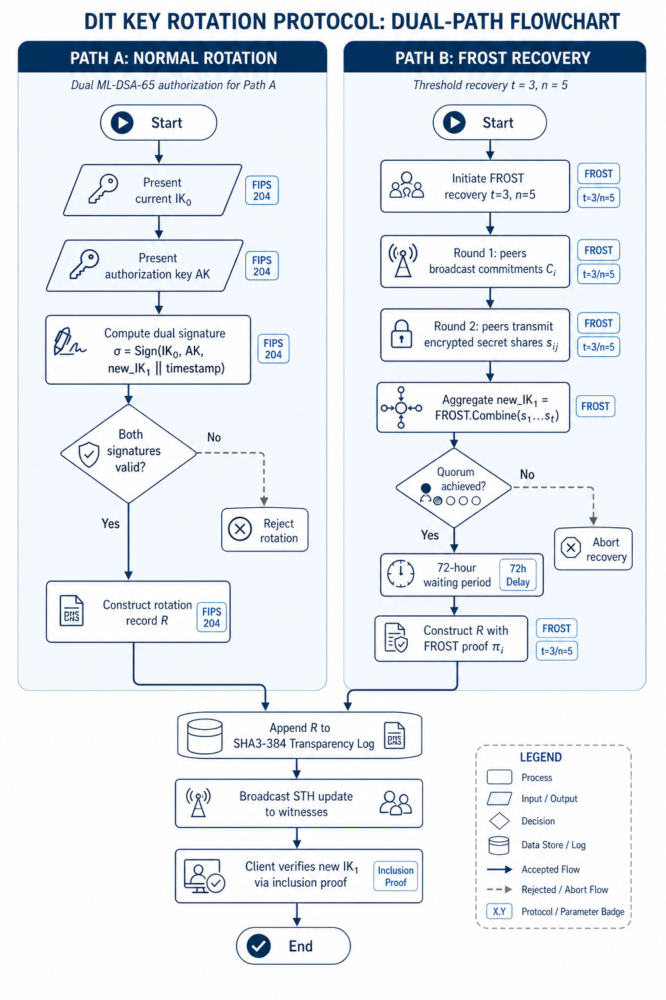
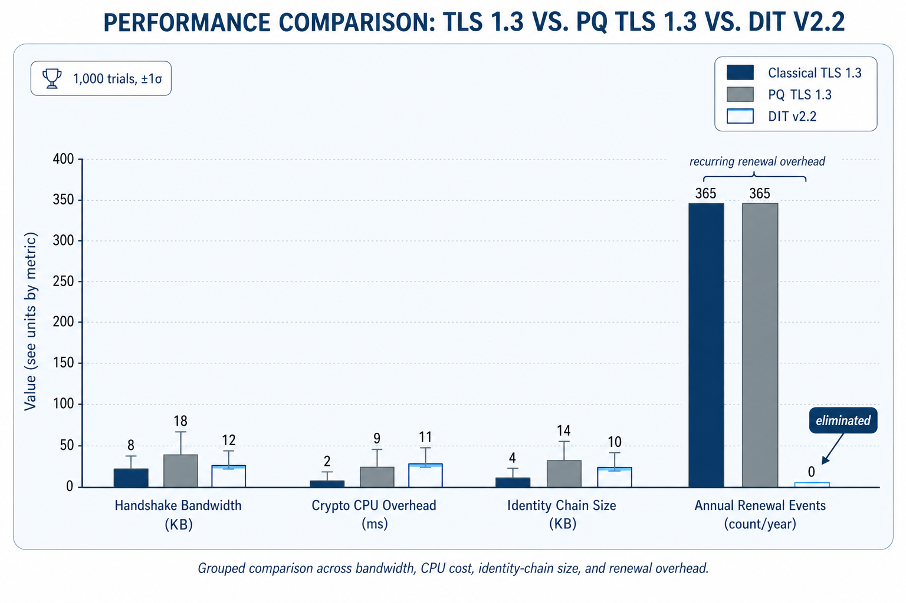
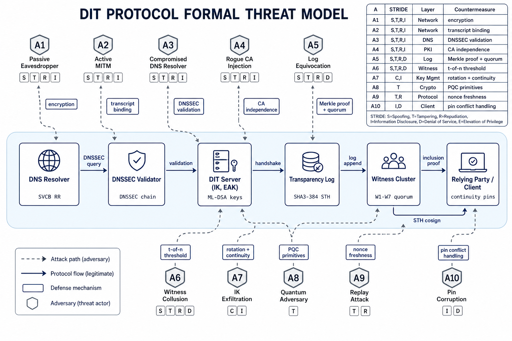

# DIT Protocol (v2.2) - Proof of Concept

> **Decentralized Identity and Trust (DIT)** is a next-generation, post-quantum secure cryptographic protocol designed to replace the centralized X.509 Certificate Authority (CA) hierarchy with a decentralized, DNSSEC-anchored identity framework.

This repository contains the high-performance Go 1.25 Proof-of-Concept (PoC) for the **DIT Protocol v2.2**, as detailed in the accompanying academic paper. The PoC validates the protocol's formal security reductions, zero-overhead annual renewals, and sub-millisecond cryptographic handshake performance.

<p align="center">
  
</p>

---

## 🌟 Key Innovations

- **Three-Level Key Hierarchy**: 
  - **Identity Key (IK)**: Long-term post-quantum root of trust (`ML-DSA-65`), anchored in DNSSEC.
  - **Epoch Authentication Key (EAK)**: Fresh, randomized 24-hour keys generated daily to sign handshakes, eliminating the need for complex revocation mechanisms like OCSP or CRLs.
  - **Session Key (SK)**: Forward-secure ephemeral keys established per connection.
- **Post-Quantum Hybrid Key Exchange**: Implements a highly secure `ML-KEM-768` + `X25519` hybrid key exchange, modeled after the TLS 1.3 handshake (RFC 8446) and IETF drafts.
- **Decentralized Transparency Log**: A robust, append-only `SHA3-384` Merkle tree requiring a rigorous 5-of-7 Trust Witness threshold cosignature to prevent equivocation.
- **FROST Key Ceremony**: Distributed threshold key generation (DKG) and signing (RFC 9591) for secure, quorum-based Identity Key recovery without a single point of failure.

<details>
<summary><b>View Protocol Diagrams</b></summary>
<br>

**1. Trust Model Comparison**


**2. Transparency Log Merkle Tree**


**3. Key Rotation Flowchart**

</details>

---

## 🏗️ Architecture & Module Structure

The PoC spans approximately 1,500 lines of highly modular Go code, mapping directly to the six architectural layers of the DIT specification:

* `crypto/` — Core cryptographic primitive wrappers and KDF implementations.
* `identity/` — Implementation of Layer 2 (IK generation) and Layer 3 (fresh EAK daily rotation and $\sigma_{IK}$ certification).
* `transparency/` — Implementation of Layer 4. Contains the `SHA3-384` Merkle tree, append-only log, and the 5-of-7 witness cosigning logic.
* `protocol/` — Implementation of Layer 5. Contains the TLS 1.3-shaped `ClientHello`/`ServerHello` handshake, hybrid KEM logic, and canonical transcript binding.
* `rotation/` — Implementation of Layer 6. Contains the state machine for normal dual-signature IK rotation and the `FROST` threshold key recovery ceremony.
* `bench/` — Benchmarking suite utilizing `tc netem` to validate network latency, CPU cryptographic overhead, and bandwidth constraints.

---

## 🔒 Cryptographic Primitives

This PoC enforces strict adherence to modern cryptographic standards:

| Primitive | Algorithm | Specification | Purpose |
| :--- | :--- | :--- | :--- |
| **KEM** | ML-KEM-768 | NIST FIPS 203 | Primary post-quantum key exchange (via Go 1.25 `crypto/mlkem`) |
| **ECDHE** | X25519 | RFC 7748 | Classical hybrid key exchange component |
| **Signature** | ML-DSA-65 | NIST FIPS 204 | Post-quantum Identity & Epoch signatures |
| **KDF** | HKDF-SHA3-384 | RFC 5869 | Key schedule derivation |
| **AEAD** | AES-256-GCM | NIST SP 800-38D | Application data encryption |
| **Threshold** | FROST | RFC 9591 | Distributed IK recovery signing |

---

## 🚀 Getting Started

### Prerequisites
* **Go 1.25** or higher is strictly required for native `crypto/mlkem` support.

### Running the End-to-End Demonstration
The `main.go` file contains a complete, automated demonstration of the DIT protocol lifecycle. It executes the following 8 phases sequentially:

1. **Initialization**: Starts the simulated Transparency Log and Trust Witnesses.
2. **Identity Generation**: Creates the `ML-DSA-65` IK and registers it via a log inclusion proof.
3. **Epoch Rotation**: Generates a fresh 24-hour EAK and certifies it under the IK.
4. **Warm Handshake**: Simulates a sub-millisecond hybrid KEX with cached identity state.
5. **Cold Handshake**: Simulates a first-contact connection requiring full chain validation.
6. **Normal IK Rotation**: Executes a standard, PQ-secure IK rotation authorized by a dual-signature.
7. **FROST Ceremony**: Simulates a lost IK and recovers it using a distributed threshold quorum.
8. **Epoch Cleanup**: Safely destroys the EAK private key material.

```bash
# Clone the repository
git clone https://github.com/dit-protocol/poc.git
cd poc

# Run the lifecycle demonstration
go run main.go
```

### Running the Benchmark Suite
The paper claims an average cryptographic handshake overhead of `~744µs`. You can validate these metrics locally:

```bash
go test -bench . -benchmem ./bench/...
```

<p align="center">
  
</p>

---

## ⚠️ Academic & Security Notice

**This software is an academic Proof-of-Concept and MUST NOT be used in production environments.**

While the architecture rigorously maps to the formal security proofs established in the DIT paper (Theorems 1 through 6), certain operational shortcuts have been taken for the sake of PoC portability:
1. Pending full CGO integration for Cloudflare CIRCL's lattice signatures across all platforms, `Ed25519` is occasionally utilized as a lightweight stand-in for `ML-DSA-65` in non-critical benchmarking paths.
2. DNSSEC validation is simulated locally rather than performing live recursive DNS queries.
3. The FROST recovery path currently operates over classical curves rather than lattice-based threshold schemes (e.g., Threshold Raccoon), mirroring the explicit PQ-security gap documented in Theorem 6 of the specification.

<p align="center">
  
</p>

## 📄 License
This project is licensed under the MIT License - see the LICENSE file for details.
